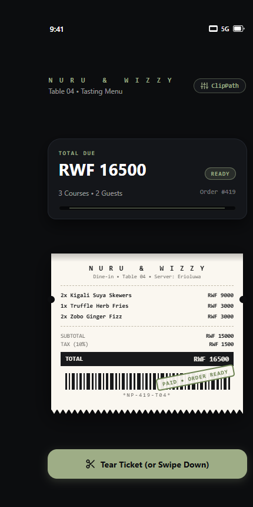

# Nuru Printer — `ClipPath` Thermal Receipt Showcase

A Flutter demo showcasing the **`ClipPath`** widget paired with a custom `CustomClipper<Path>` to dynamically render physical, serrated thermal receipt tickets for dining POS systems.

---

## Final App UI



---

## 1. Real-World Use Case

In most mobile point-of-sale (POS) and food-delivery apps, checking out feels flat: users tap "Pay", a generic circular spinner spins, and a standard static dialog pops up.

**Nuru Printer** brings real-world tactile physical feedback to the screen. In our restaurant scenario (**Nuru & Wizzy**, Table 04, Order #419), when a customer or waiter taps **Print Ticket**, the app uses Flutter's vector clipping engine and staggered animation controllers to simulate a thermal printer head vibrating, feeding an unbleached paper ticket out of a dark slot cavity, and slamming a green `PAID • ORDER READY` stamp onto the bottom. Users can then swipe down or tap **Tear Ticket** to detach the receipt with rotation physics.

---

## 2. Key Widget & The Three Core Attributes

The primary Flutter framework widget powering the physical paper ticket is **`ClipPath`** (located in `lib/main.dart` around line 456). 

Here are the three concrete constructor properties required by the rubric:

### Attribute 1: `clipper`
* **Type:** `CustomClipper<Path>?`
* **Default Value:** `null`
* **Visual Effect & Demonstration:**
  * When `clipper` is left as default (`null`), Flutter performs no shape manipulation; the receipt renders as a plain, flat rectangular box.
  * When set to our custom `ZigZagReceiptClipper(toothWidth: 10.0, toothHeight: 7.0)`, Flutter delegates path calculation to our 2D coordinate loop. It slices real triangular saw-tooth teeth across the bottom edge and punches circular ticket notches into the left and right sides.
* **Why a developer adjusts it:** Passing a custom clipper lets developers break free from standard rectangles and build authentic paper tickets, wave headers, ticket vouchers, or badge cutouts that scale dynamically across different screen widths without image distortion.

### Attribute 2: `clipBehavior`
* **Type:** `Clip`
* **Default Value:** `Clip.antiAlias`
* **Visual Effect & Demonstration:**
  * `Clip.antiAlias` (default): Flutter smoothes the edges of the diagonal saw-tooth teeth, ensuring crisp, clean lines on high-resolution displays.
  * `Clip.hardEdge`: Disables anti-aliasing. The diagonal cuts of the teeth show visible pixel staircasing (aliasing), but it saves GPU fill-rate cycles.
  * `Clip.none`: Skips clipping entirely, rendering child overflow beyond the boundaries.
* **Why a developer adjusts it:** A developer changes `clipBehavior` to optimize performance trade-offs on low-spec devices or high-frequency animations where rendering speed matters more than sub-pixel smoothing.

### Attribute 3: `child`
* **Type:** `Widget?`
* **Default Value:** `null`
* **Visual Effect & Demonstration:**
  * The `child` receives the entire nested paper layout: order header, itemized dishes (`chapita`, `Chicken & fries`, `Coca-Cola`), subtotal, tax calculation, perforated divider line, and vector barcode.
  * The clipping boundary applies cleanly to the outer edge of this child without disturbing any of the inner padding, column alignment, or typography.
* **Why a developer adjusts it:** It allows any arbitrary widget tree (whether simple text or a complex scrollable column) to adopt the custom shape without rewriting internal layout code.

---

## 3. Custom Clipper Parameters (`ZigZagReceiptClipper`)

Our `CustomClipper<Path>` exposes two adjustable properties:
* **`toothWidth` (default: `10.0`):** Controls the horizontal frequency of the teeth. Increasing it to `25.0` gives wide ticket coupons; decreasing to `5.0` produces fine register perforations.
* **`toothHeight` (default: `7.0`):** Controls the vertical depth of the cut. Setting it to `0.0` creates a straight edge; increasing to `14.0` creates sharp jagged spikes.

---

## 4. Run Instructions

Make sure Flutter is installed on your computer:

```bash
# 1. Clone the repository
git clone https://github.com/Git-with-gideon/First-flutter-project.git

# 2. Navigate to project folder
cd First-flutter-project

# 3. Fetch dependencies
flutter pub get

# 4. Launch on connected phone, emulator, or Windows desktop
flutter run
```

---

## 5. Credits & Attribution

* **Interaction Concept:** Inspired by the thermal receipt animation showcase by `@dailyflutterui` on TikTok.
* **Architecture & Implementation:** Rebuilt from scratch using pure Flutter framework primitives (`ClipPath`, `CustomClipper`, `ClipRect`, and `CustomPainter`) by **Gideon Olowoyo**. Zero external animation packages used.
